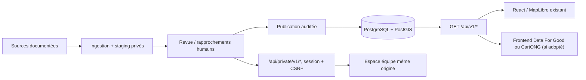

# Architecture technique — domaines isolés et frontend interchangeable

> Statut : architecture du **prototype indépendant Memo Labs**. Ce n'est pas une décision de Data For Good, de SOS MEDITERRANEE ni de CartONG. Aucun dépôt partenaire n'est modifié.

## Architecture et code existants

- Backend : Django 5.2 LTS, DRF, drf-spectacular, PostgreSQL/PostGIS.
- Frontend actuel : React, TypeScript, Vite, MapLibre, TanStack Query.
- API publique : `/api/v1/`, lecture uniquement, ressources `events`, `map-points`, `timeline`, `evidence`.
- API équipe : `/api/private/v1/`, session et CSRF, sans CORS public.
- Contrat machine : `contracts/openapi.yaml`, génération `frontend/src/api/schema.d.ts`.
- En production, les fichiers React existants restent servis par le backend. L'API publique peut également alimenter un second frontend après autorisation explicite d'origine.

## Refactoring de domaines, sans migration de schéma

Le module `catalog` reste **l'unique application Django** : app label, tables `catalog_*`, migrations et permissions sont conservés. Les implémentations des modèles sont séparées en sous-modules de `catalog.models` ; l'API `from catalog.models import Event` reste valide.

```text
backend/catalog/
  models/
    __init__.py       # API historique stable, tous les modèles réexportés
    base.py           # UUID et horodatage
    sources.py        # Source et droits
    events.py         # Navires, voyages, opérations, preuves, révisions
    geography.py      # Ports et alias
    ingestion.py      # Lots, snapshots, lignes, identités, synchronisation
    publication.py    # Journal des décisions
    accounts.py       # Invitations
  ingestion/
    imports.py        # Validation et import JSON idempotent
  review/
    crosswalk.py     # Identités et correspondances approuvées
    drafts.py        # Traduction des lignes revues en brouillons
    revisions.py     # Corrections sourcées sans écrasement silencieux
  publication/
    services.py       # Décision transactionnelle et audit
  public_api/
    views.py          # API de lecture, filtres et sérialisation
  api.py              # Façade compatible pour URLs et tests existants
  imports.py          # Façade compatible pour imports existants
  services.py         # Façade compatible pour publication existante
  crosswalk.py / drafts.py / revisions.py  # Façades des services de revue
```

Les services de revue (`crosswalk`, `drafts`, `revisions`) vivent désormais dans `catalog.review` ; les anciennes importations restent utilisables via des façades. Le reste (`sheets`, `sync`, API privées) reste en place jusqu'à extraction **par lots testés**. Les modèles sont séparés sans leur attribuer de nouveaux labels Django.

## Contrat pour raccorder un frontend partenaire



Le frontend **ne possède aucune règle de publication** : il ne fait que consulter les projections du backend. Les règles de droits, statut, données fictives et retrait sont vérifiées à chaque requête.

Les endpoints, formes de réponse et filtres sont documentés dans OpenAPI. Le client externe doit générer ses types depuis ce contrat. Le tableau, le journal et la carte doivent traiter `null` comme inconnu et jamais comme zéro.

### Deux modes d'hébergement

1. **Même origine (recommandé)** : un proxy sert l'interface et transfère `/api/` au backend. Permet les interfaces privées avec cookies HttpOnly/CSRF sans CORS.
2. **Frontend public séparé** : `PUBLIC_FRONTEND_ORIGINS=https://atlas.partner.example` active le CORS explicite sur les lectures `GET/HEAD /api/v1/`, sans identifiants. Aucun accès privé cross-origin. En production seules des origines HTTPS exactes sont autorisées.

CORS ne remplace ni la licence des données ni les contrôles de publication. Aucune connexion ni donnée métier ne doit être exposée hors de la politique validée avec SOS.

## Contraintes invariantes

- Une donnée importée est privée, jamais publiée automatiquement.
- Un nombre ou une position inconnue demeure `null`.
- Les références d'origine et décisions humaines restent traçables.
- Publication = permission + accord sur la réutilisation + motif enregistré, dans une transaction.
- L'application continue sans WebGL via les vues liste.
- Pas de migration automatique vers des microservices / files de tâches / Redis.
- Tests obligatoires : Django/PostGIS, migration sans dérive, contrat OpenAPI, lint, frontend et Playwright.

## Travaux suivants, sous tickets séparés

1. Maintenir des tests de compatibilité des imports legacy et des décisions de revue, sans modifier les règles de publication.
2. Extraire le traitement des Sheets et des lecteurs périodiques vers `catalog.ingestion`, avec verrous, erreurs de réseau, reprises et métriques.
3. Clarifier les adaptateurs de publication/export pour la carte historique : voir #57.
4. Contractualiser les sources, les droits et le périmètre réel avec SOS : voir #48.
5. Faire vérifier le parcours complet login → revue → publication → retrait : voir #45 / PR #55 avant de déclarer une mise en production.

Les migrations historiques sont la source de vérité, pas la simple structure des fichiers. Toute extraction demande `makemigrations --check --dry-run` et test de démarrage Django avant intégration.
